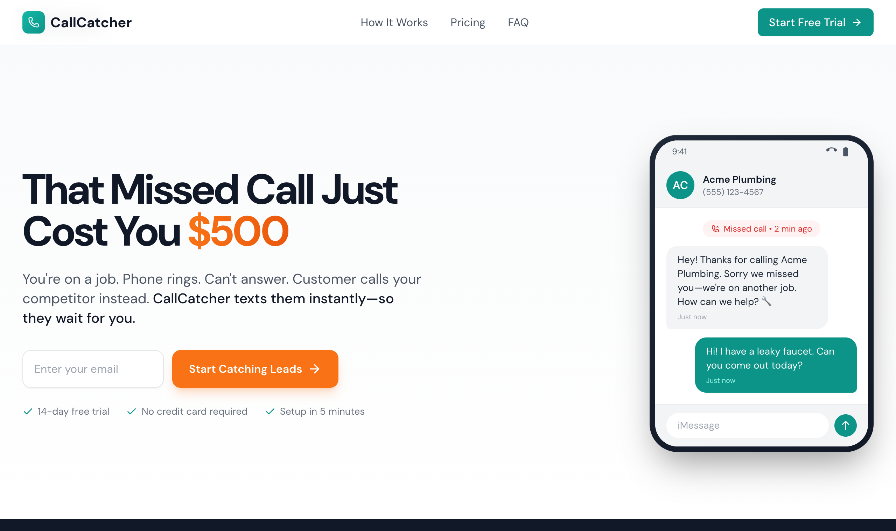
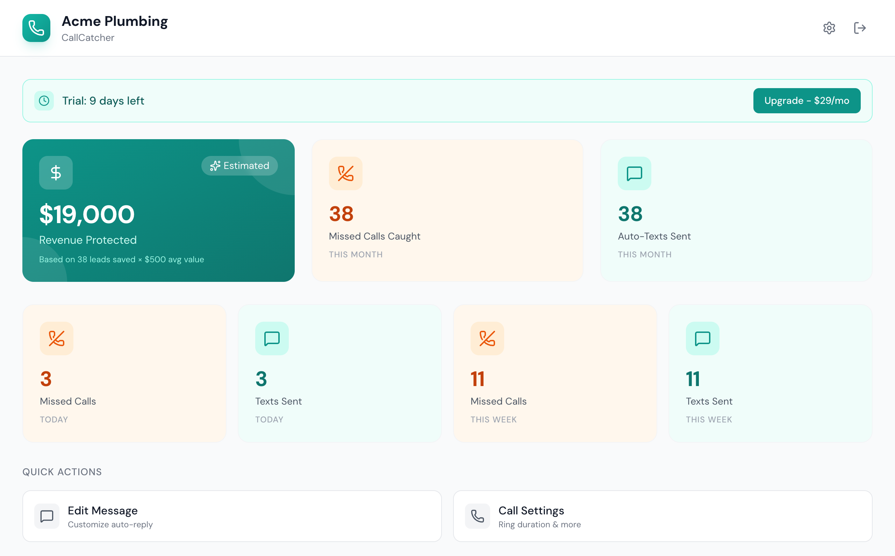

# CallCatcher

<div align="center">
  
</div>

<div align="center">

[](https://nextjs.org/)
[](https://supabase.com/)
[](https://twilio.com/)
[](https://stripe.com/)

</div>

**Auto-text customers when you miss their call. Stop losing $500+ leads to voicemail.**

<p align="center">
  
</p>

<p align="center">
  
</p>

---

## TL;DR

**The Problem**: Small businesses miss calls while they work. Each missed call can be a $500 job walking away to a competitor who answered.

**The Solution**: CallCatcher gives you a dedicated business phone number. When you miss a call, we instantly text the customer: *"Sorry we missed you! How can we help?"* — keeping the lead warm until you can call back.

### Why Use CallCatcher?

| Feature | What It Does |
|---------|--------------|
| **Instant Auto-Text** | Texts customer within seconds of missed call |
| **Smart Templates** | Personalized messages with your business name & hours |
| **Conversation Inbox** | Continue the conversation via text from your dashboard |
| **Revenue Tracking** | See how much money you're saving (leads × $500) |
| **14-Day Free Trial** | Test with real customers, no credit card required |

---

## How It Works

```
1. Customer calls your CallCatcher number
2. Call forwards to your personal phone
3. If you miss it → Customer gets instant text
4. Customer replies → You see it in your dashboard
5. You call back → Lead saved!
```

```
┌─────────────────┐     ┌─────────────────┐     ┌─────────────────┐
│  Customer Call  │────▶│  CallCatcher    │────▶│  Your Phone     │
└─────────────────┘     │  (Twilio)       │     └─────────────────┘
                        └────────┬────────┘              │
                                 │                       │
                           Missed?                  Answered?
                                 │                       │
                                 ▼                       ▼
                        ┌─────────────────┐     ┌─────────────────┐
                        │  Auto-Text Sent │     │  Normal Call    │
                        │  "Sorry we..."  │     │  (No action)    │
                        └─────────────────┘     └─────────────────┘
```

---

## Tech Stack

- **Frontend**: Next.js 14 (App Router), React 18, Tailwind CSS
- **Database**: Supabase (PostgreSQL + Auth + Row Level Security)
- **Phone/SMS**: Twilio (Phone number provisioning, Voice, SMS)
- **Payments**: Stripe (Subscriptions, Billing Portal)
- **Deployment**: Vercel (recommended)

---

## Local Development

### Prerequisites

- Node.js 18+
- npm or yarn
- [Supabase account](https://supabase.com/) (free tier works)
- [Twilio account](https://twilio.com/) (trial works for testing)
- [Stripe account](https://stripe.com/) (test mode)
- [ngrok](https://ngrok.com/) (for Twilio webhooks in development)

### 1. Clone & Install

```bash
git clone https://github.com/ProofOfReach/callcatcher.git
cd callcatcher
npm install
```

### 2. Environment Variables

Copy `.env.example` to `.env.local` and fill in your keys:

```bash
# Supabase
NEXT_PUBLIC_SUPABASE_URL=https://your-project.supabase.co
NEXT_PUBLIC_SUPABASE_ANON_KEY=your-anon-key
SUPABASE_SERVICE_ROLE_KEY=your-service-role-key

# Twilio
TWILIO_ACCOUNT_SID=ACxxxxxxxxxx
TWILIO_AUTH_TOKEN=your-auth-token

# Stripe
STRIPE_SECRET_KEY=sk_test_xxxxxxxxxx
STRIPE_WEBHOOK_SECRET=whsec_xxxxxxxxxx
STRIPE_PRICE_ID=price_xxxxxxxxxx

# Base URL (use ngrok for local dev)
NEXT_PUBLIC_BASE_URL=https://your-ngrok-url.ngrok-free.dev

```

### 3. Database Setup

Run migrations in your Supabase SQL Editor:

```sql
-- See supabase/migrations/ for full schema
-- Key tables: users, profiles, messages, calls, opt_outs
```

Run the files in `supabase/migrations/` in order: `initial_schema`, `add_stripe_customer_id`, `sync_auth_users`.

### 4. Start ngrok (for Twilio webhooks)

```bash
ngrok http 3000
```

Update `NEXT_PUBLIC_BASE_URL` in `.env.local` with your ngrok URL.

### 5. Run Development Server

```bash
npm run dev
```

Open [http://localhost:3000](http://localhost:3000).

---

## Project Structure

```
src/
├── app/
│   ├── page.tsx                    # Landing page
│   ├── onboarding/                 # Business profile setup
│   │   ├── page.tsx                # Step 1: Business info
│   │   └── phone/page.tsx          # Step 2: Phone provisioning
│   ├── dashboard/
│   │   ├── page.tsx                # Main dashboard
│   │   ├── settings/               # User settings
│   │   └── conversations/[phone]/  # Message thread view
│   ├── api/
│   │   ├── twilio/                 # Twilio webhooks
│   │   │   ├── voice/route.ts      # Incoming call handler
│   │   │   ├── sms/route.ts        # Incoming SMS handler
│   │   │   └── status/route.ts     # Call status callback
│   │   └── stripe/webhook/         # Stripe subscription webhooks
│   └── auth/callback/              # Supabase OAuth callback
├── components/
│   ├── DashboardContent.tsx        # Dashboard UI
│   ├── ConversationsList.tsx       # Message inbox
│   ├── TrialBanner.tsx             # Subscription status
│   └── ...
├── lib/
│   ├── supabase/                   # Supabase client setup
│   ├── twilio.ts                   # Twilio client
│   ├── twilio-actions.ts           # Phone provisioning
│   ├── stripe.ts                   # Stripe client
│   └── stripe-actions.ts           # Checkout/portal sessions
└── types/
    └── database.ts                 # TypeScript types for DB
```

---

## Twilio Webhook URLs

Configure these in Twilio Console or they're auto-set when provisioning:

| Webhook | URL | Purpose |
|---------|-----|---------|
| Voice | `{BASE_URL}/api/twilio/voice` | Handle incoming calls |
| SMS | `{BASE_URL}/api/twilio/sms` | Handle incoming texts |
| Status Callback | `{BASE_URL}/api/twilio/status` | Track call status (missed/answered) |

---

## Stripe Products

Create these in Stripe Dashboard:

1. **Monthly Subscription** - $29/month
2. Set `STRIPE_PRICE_ID` to the price ID

The webhook handles:
- `checkout.session.completed` - Activate subscription
- `customer.subscription.updated` - Status changes
- `customer.subscription.deleted` - Cancellation

---

## Deployment

### Vercel (Recommended)

1. Push to GitHub
2. Import in Vercel
3. Add environment variables
4. Deploy

### Environment Variables for Production

- Update `NEXT_PUBLIC_BASE_URL` to your production domain
- Use production Stripe keys
- Ensure Twilio webhooks point to production URLs

---

## Troubleshooting

### "VoiceUrl is not valid: http://localhost..."

Twilio can't reach localhost. You need ngrok:

```bash
ngrok http 3000
# Update NEXT_PUBLIC_BASE_URL with the ngrok URL
```

### "Failed to create profile"

The auth user sync trigger might be missing. Run:

```sql
-- In Supabase SQL Editor
INSERT INTO public.users (id, email)
SELECT id, email FROM auth.users
ON CONFLICT (id) DO NOTHING;
```

### CSS not loading / 404 errors

Clear the Next.js cache:

```bash
rm -rf .next
npm run dev
```

---

## Limitations

- **US phone numbers only** - Twilio restriction for SMS
- **Single phone forwarding** - Forwards to one personal number
- **No MMS support** - Text only, no picture messages
- **14-day trial** - Requires subscription after trial

---

## FAQ

### How much does it cost?

$29/month after 14-day free trial. Includes unlimited missed call texts.

### Do I need to change my business number?

No. You get a new CallCatcher number. Update your Google Business listing with the new number.

### What happens if I cancel?

Your CallCatcher number is released. Customers calling it will get a disconnected message.

### Is my data secure?

Yes. All data is stored in Supabase with Row Level Security. Each user can only access their own data.

---

## License

[MIT](LICENSE)

---

<div align="center">
  <p>Built with Next.js, Supabase, Twilio, and Stripe</p>
  <p>Stop losing leads. Start catching calls.</p>
</div>
